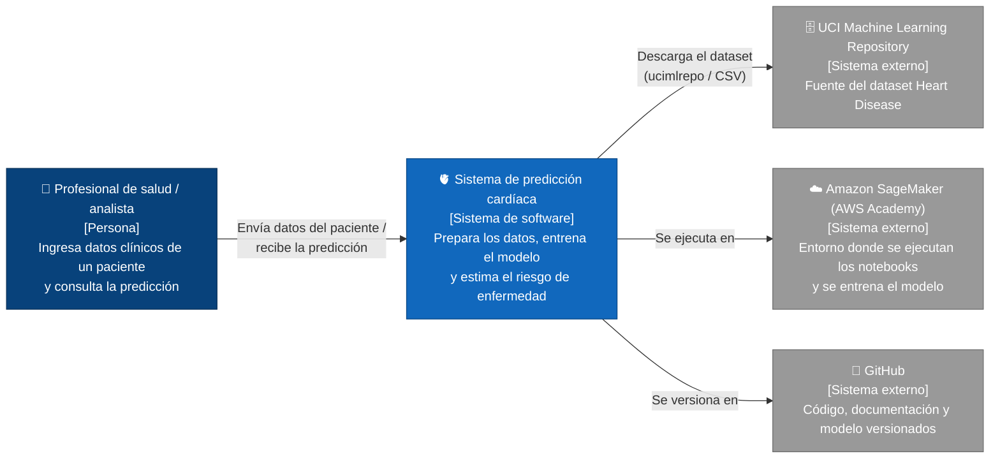
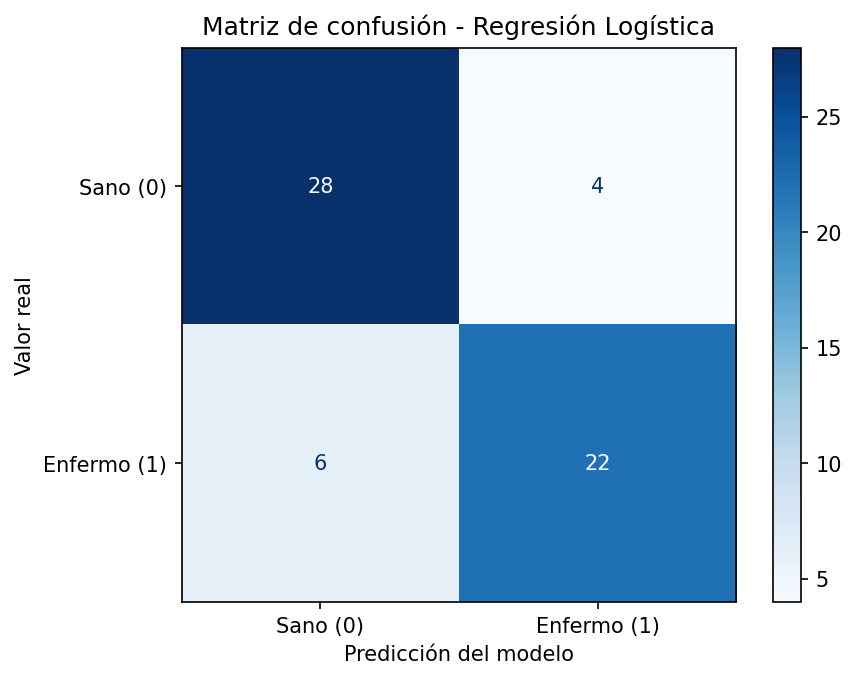

# proyectoFinal_prediccionCardiaca

> Mini‑proyecto de Machine Learning: predicción de enfermedad cardíaca a partir de datos clínicos, con evaluación de métricas y análisis ético.

**Integrantes**

| Nombre | Rama | Rol |
|---|---|---|
| Pablo Alejandro Mafla Ayala | `dev_pmafla58` | Datos y ética |
| Santiago Chacón Serrano | `dev_schacon46` | Modelo y evaluación |

**Documentos del proyecto**

- Informe completo (PDF): [`docs/informe.pdf`](docs/informe.pdf)
- Notebook de datos: [`notebooks/01_datos.ipynb`](notebooks/01_datos.ipynb)
- Notebook del modelo: [`notebooks/02_modelo.ipynb`](notebooks/02_modelo.ipynb)

---

## 1. Problema, datos y solución

### 1.1 ¿Qué problema resolvemos?
Las enfermedades cardiovasculares constituyen una de las principales causas de mortalidad a nivel global, y su detección temprana resulta crítica para mejorar el pronóstico clínico de los pacientes. Este proyecto implementa un modelo supervisado de clasificación binaria basado en Regresión Logística para predecir la presencia o ausencia de enfermedad cardíaca (`target`: 1 = presencia, 0 = ausencia) a partir de 13 variables clínicas y demográficas del dataset Heart Disease (UCI). El sistema está diseñado estrictamente como una herramienta de soporte a la decisión clínica (triaje preliminar) y en ningún caso reemplaza el diagnóstico ni el criterio de un profesional médico.

### 1.2 ¿Con qué datos?
Se utiliza el dataset **Heart Disease (cohorte de Cleveland)**, proveniente del repositorio de **UCI Machine Learning**. El conjunto de datos original cuenta con **303 pacientes** y **13 variables predictoras** clínicas y demográficas. La variable objetivo a predecir es **`target`**.

| Variable | Descripción | Tipo |
| :--- | :--- | :--- |
| age | Edad en años | Numérica |
| sex | Sexo (1 = hombre, 0 = mujer) | Categórica |
| cp | Tipo de dolor de pecho (0 a 3) | Categórica |
| trestbps | Presión arterial en reposo (mm Hg) | Numérica |
| chol | Colesterol sérico (mg/dl) | Numérica |
| fbs | Azúcar en sangre en ayunas > 120 mg/dl (1 = sí, 0 = no) | Categórica |
| restecg | Resultados electrocardiográficos en reposo (0 a 2) | Categórica |
| thalach | Frecuencia cardíaca máxima alcanzada | Numérica |
| exang | Angina inducida por el ejercicio (1 = sí, 0 = no) | Categórica |
| oldpeak | Depresión del ST inducida por el ejercicio | Numérica |
| slope | Pendiente del segmento ST máximo durante el ejercicio (0 a 2) | Categórica |
| ca | Número de vasos principales coloreados por fluoroscopía (0 a 3) | Numérica |
| thal | Estado de talasemia (0 a 3) | Categórica |
| target | 1 = tiene enfermedad cardíaca, 0 = no | Objetivo |
### 1.3 ¿Cómo funciona la solución?
La solución sigue el workflow básico de Machine Learning en cinco etapas, cada una implementada en un script de `src/`:

1. **Carga (`datos.py`):** Descarga el dataset Heart Disease desde UCI y lo guarda en `data/heart_disease.csv`.
2. **Preparación (`preprocesamiento.py`):** Elimina los 6 registros con valores faltantes y divide los 297 pacientes restantes en entrenamiento (80 %) y prueba (20 %) de forma estratificada.
3. **Entrenamiento (`modelo.py`):** Entrena un modelo de referencia (`DummyClassifier`) y una Regresión Logística dentro de un Pipeline con `StandardScaler`, y los guarda en `models/`.
4. **Evaluación (`evaluacion.py`):** Calcula Accuracy, Precision, Recall y F1‑Score de ambos modelos con el conjunto de prueba y genera la matriz de confusión.
5. **Predicción (`predecir.py`):** Usa el modelo entrenado para estimar la probabilidad de enfermedad de un paciente nuevo.

El proceso completo, con sus resultados, se puede ver en `notebooks/01_datos.ipynb` y `notebooks/02_modelo.ipynb`.

### 1.4 ¿Cómo demostramos que los resultados son válidos?
- **Datos que el modelo nunca vio:** Llas métricas se calculan con 60 pacientes de prueba que no se usaron durante el entrenamiento.
- **Sin fuga de información:** El escalado de las variables se ajusta solo con los datos de entrenamiento, porque va dentro del Pipeline del modelo.
- **Comparación con un modelo de referencia:** El modelo se compara con un `DummyClassifier` que siempre predice la clase más frecuente, para comprobar que realmente aprende.
- **Criterios de aceptación definidos:** El modelo se evalúa contra los criterios de la sección 4.5.
- **Reproducibilidad:** La división usa una semilla fija (`random_state=42`), así que cualquier persona obtiene los mismos resultados al ejecutar los comandos de la sección 1.5.
### 1.5 Cómo ejecutar el proyecto

El proyecto se desarrolló y ejecutó en **Amazon SageMaker** (instancia de notebook del Laboratorio 3.1 de AWS Academy, kernel `conda_python3`). También funciona en cualquier computador con Python 3.10 o superior.

En la terminal de JupyterLab:

```bash
cd ~/SageMaker/proyectoFinal_prediccionCardiaca
source activate python3          # solo en SageMaker: usa el mismo Python que los notebooks
pip install -r requirements.txt
python src/datos.py              # descarga el dataset de UCI (solo la primera vez)
python src/preprocesamiento.py   # prepara y divide los datos
python src/modelo.py             # entrena el modelo de referencia y el modelo final
python src/evaluacion.py         # calcula métricas y matriz de confusión
python src/predecir.py           # predice para un paciente nuevo
```

---

## 2. Alcance del sistema

### ✅ Qué hará el sistema
* Descargar, limpiar y particionar de forma estratificada (80% entrenamiento / 20% prueba) el dataset clínico de enfermedades cardíacas de la UCI.
* Entrenar un pipeline reproducible que integra estandarización de características (`StandardScaler`) y un modelo de Regresión Logística interpretable.
* Evaluar cuantitativamente el desempeño del clasificador frente a un modelo base (`DummyClassifier`) utilizando Accuracy, Precision, Recall, F1-Score y Matriz de Confusión.
* Auditar la equidad del modelo desglosando métricas de sensibilidad (Recall) y precisión por sexo biológico.
* Generar predicciones individuales con probabilidades asociadas para pacientes nuevos mediante consola.
  
### ❌ Qué NO hará el sistema
* **No emitirá diagnósticos médicos definitivos** ni prescribirá tratamientos clínicos.
* **No procesará historias clínicas con datos personales identificables (PII)** ni se conectará en tiempo real a sistemas hospitalarios (HIS/EHR).
* **No operará como interfaz gráfica web ni API en producción continua**, limitándose a ejecución por scripts y notebooks en el entorno controlado de Amazon SageMaker.
  
### 2.1 Diagrama C4 de contexto

*   **Usuario (Personal Médico / Investigador):** Ejecuta el análisis, evalúa métricas e interpreta la predicción clínica como apoyo diagnóstico mediante la consola/JupyterLab.
*   **Sistema (Sistema ML de Predicción Cardíaca):** Preprocesa datos clínicos, entrena el modelo de Regresión Logística, evalúa equidad y estima la probabilidad de enfermedad cardíaca en AWS SageMaker.
*   **Sistema Externo (UCI Machine Learning Repository):** Fuente de datos públicos que provee el dataset clínico crudo (Heart Disease, Cleveland, 303 registros) vía HTTPS.




---


## 3. Decisiones de arquitectura (ADR)

### ADR‑01: Enfoque de implementación
- **Contexto:** El proyecto debe recorrer todo el workflow de Machine Learning (datos, entrenamiento, evaluación y predicción) de forma reproducible, y el equipo trabaja en los laboratorios de AWS Academy por la familiaridad que tenemos con ellos.
- **Decisión:** Usar Python con scikit‑learn en Amazon SageMaker (Laboratorio 3.1 de AWS Academy). La lógica va en scripts dentro de `src/` y el proceso se muestra en notebooks de JupyterLab dentro de `notebooks/`.
- **Justificación:** scikit‑learn es la librería estándar para modelos clásicos y ya viene en SageMaker. Separar scripts y notebooks permite repetir todo el proceso con pocos comandos y, a la vez, mostrar los resultados paso a paso.
- **Consecuencias:** El proyecto depende del tiempo limite de los laboratorios, aunque también corre en cualquier computador con Python. Los scripts y los notebooks deben mantenerse coherentes entre sí.

### ADR‑02: Selección del modelo
- **Contexto:** Se necesita predecir una variable binaria (enfermedad cardíaca sí o no) a partir de 13 variables clínicas, con un dataset pequeño de 297 pacientes, en un ámbito de salud donde las decisiones deben poder explicarse.
- **Decisión:** Se usará Regresión Logística dentro de un Pipeline con `StandardScaler`, y se comparará con un modelo de referencia (`DummyClassifier`) que siempre predice la clase más frecuente.
- **Justificación:** La Regresion Logistica es un modelo diseñado para clasificación binaria, funciona bien con pocos datos y es interpretable: sus coeficientes muestran qué variables influyen más en la predicción, algo clave para la transparencia en salud. El modelo de referencia permite comprobar que el modelo realmente aprende algo.
- **Consecuencias:** Al ser un modelo lineal, puede no capturar relaciones complejas entre variables. Además, trata variables categóricas como `cp` y `thal` como numéricas, lo que se podría mejorar con codificación one‑hot.

### ADR‑03: Almacenamiento y despliegue
- **Contexto:** El Laboratorio 3.1 de AWS Academy se reinicia en cada sesión y tiene tiempo límite. Además, el profesor evalúa el proyecto desde el repositorio de GitHub.
- **Decisión:** Guardar el dataset y los conjuntos de entrenamiento y prueba como archivos CSV en `data/`, guardar el modelo entrenado con `joblib` en `models/`, ejecutar todo en la instancia de notebook que provee el laboratorio y usar GitHub como almacenamiento principal.
- **Justificación:** El dataset es pequeño, así que no necesita una base de datos. La instancia del laboratorio basta para entrenar en segundos sin crear recursos adicionales. GitHub conserva el trabajo aunque el laboratorio se reinicie y permite ejecutar el proyecto sin descargar de nuevo los datos.
- **Consecuencias:** El modelo no se publica como servicio web (no hay un endpoint de SageMaker); para usarlo hay que ejecutar `src/predecir.py`. Cada sesión empieza clonando el repositorio, así que todo cambio debe subirse a GitHub antes de cerrar el laboratorio.


## 4. Calidad y evaluación del modelo

### 4.1 Estrategia de separación de datos
Los 297 pacientes, después de la limpieza, se dividieron en **80 % para entrenamiento (237)** y **20 % para prueba (60)**. La división es **estratificada** por la variable objetivo, así que ambos conjuntos tienen la misma proporción de enfermos (46 %), y usa una semilla fija (`random_state=42`) para que sea reproducible. El escalado con `StandardScaler` va dentro del Pipeline del modelo, de modo que solo aprende de los datos de entrenamiento y no hay fuga de información hacia el conjunto de prueba.

### 4.2 Métricas

| Modelo | Accuracy | Precision | Recall | F1‑Score |
|---|---|---|---|---|
| Referencia (DummyClassifier) | 0.533 | 0.000 | 0.000 | 0.000 |
| Regresión Logística | 0.833 | 0.846 | 0.786 | 0.815 |

- **Accuracy (0.833):** El modelo acierta en 50 de los 60 pacientes de prueba.
- **Precision (0.846):** De los 26 pacientes que el modelo marcó como enfermos, 22 lo estaban realmente.
- **Recall (0.786):** De los 28 pacientes realmente enfermos, el modelo detectó 22.
- **F1‑Score (0.815):** Combina Precision y Recall en una sola medida; un valor alto indica un buen equilibrio entre ambas.

**El Recall es la métrica prioritaria** En este problema: un falso negativo significa decirle a un paciente enfermo que está sano, lo que podría dejarlo sin tratamiento. Es un error mucho más grave que una falsa alarma.

### 4.3 Matriz de confusión



- **Verdaderos positivos (22):** Pacientes enfermos que el modelo detectó correctamente.
- **Verdaderos negativos (28):** Pacientes sanos que el modelo identificó como sanos.
- **Falsos positivos (4):** Pacientes sanos que el modelo marcó como enfermos. Generan una alarma innecesaria y exámenes adicionales.
- **Falsos negativos (6):** Pacientes enfermos que el modelo marcó como sanos. Es el error más grave del modelo.

### 4.4 Comparación con el modelo de referencia
El modelo de referencia siempre predice "sano", la clase más frecuente. Así acierta el 53 % de los casos sin aprender nada, pero nunca detecta a un paciente enfermo (Recall 0). La Regresión Logística lo supera en todas las métricas: **30 puntos más de Accuracy** y un Recall de 0.786 frente a 0. Esto confirma que el modelo aprende patrones reales de los datos.

### 4.5 Criterios de aceptación
- [ ] **Recall ≥ 0.80 en el conjunto de prueba.** No se cumple: el Recall es 0.786, ligeramente por debajo. Se propone ajustar el umbral de decisión del modelo para priorizar la detección de enfermos (ver recomendaciones en el informe).
- [x] **F1‑Score ≥ 0.75.** Se cumple: 0.815.
- [x] **Supera al modelo de referencia en todas las métricas.** Se cumple.
- [ ] **La diferencia de Recall entre hombres y mujeres es menor a 0.10.** Pendiente: se evalúa en el análisis de equidad.
- [x] **El proyecto se ejecuta de principio a fin con los comandos de la sección 1.5.** Se cumple.

## 6. Glosario

| Término | Definición |
|---|---|
| Accuracy | _TODO_ |
| Precision | _TODO_ |
| Recall | _TODO_ |
| F1‑Score | _TODO_ |
| Matriz de confusión | _TODO_ |
| Sobreajuste | _TODO_ |
| Fuga de información | _TODO_ |
| Modelo de referencia (baseline) | _TODO_ |
| Amazon SageMaker | _TODO_ |
| Instancia de notebook | _TODO_ |
| ... | ... |

## 7. Referencias

- Janosi, A., Steinbrunn, W., Pfisterer, M., & Detrano, R. (1989). *Heart Disease* [Dataset]. UCI Machine Learning Repository. https://doi.org/10.24432/C52P4X
- Pedregosa, F. et al. (2011). Scikit‑learn: Machine Learning in Python. *JMLR*, 12, 2825‑2830.
- Amazon Web Services. *Create an Amazon SageMaker notebook instance*. https://docs.aws.amazon.com/sagemaker/latest/dg/howitworks-create-ws.html
- _TODO: agregar las demás fuentes usadas (documentación, artículos sobre ética, C4, ADR)._
