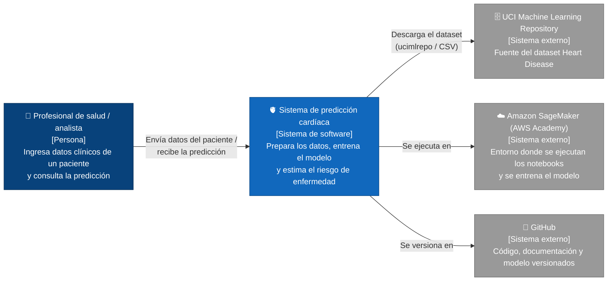

# proyectoFinal_prediccionCardiaca

> Mini‑proyecto de Machine Learning: predicción de enfermedad cardíaca a partir de datos clínicos, con evaluación de métricas y análisis ético.

**Integrantes**

| Nombre | Rama | Rol |
|---|---|---|
| _Nombre integrante 1_ | `dev_xxxx` | Datos y ética |
| _Nombre integrante 2_ | `dev_xxxx` | Modelo y evaluación |

**Documentos del proyecto**

- Informe completo (PDF): [`docs/informe.pdf`](docs/informe.pdf)
- Notebook de datos: [`notebooks/01_datos.ipynb`](notebooks/01_datos.ipynb)
- Notebook del modelo: [`notebooks/02_modelo.ipynb`](notebooks/02_modelo.ipynb)

---

## 1. Problema, datos y solución

### 1.1 ¿Qué problema resolvemos?
_TODO (Integrante 1): explicar en 3‑5 líneas el problema. Ejemplo: la enfermedad cardíaca es una de las principales causas de muerte; un modelo que ayude a identificar pacientes en riesgo puede apoyar (no reemplazar) el diagnóstico médico._

### 1.2 ¿Con qué datos?
_TODO (Integrante 1): nombre del dataset, fuente, número de pacientes y variables, variable objetivo. Tabla con las variables:_

| Variable | Descripción | Tipo |
|---|---|---|
| age | Edad en años | Numérica |
| sex | Sexo (1 = hombre, 0 = mujer) | Categórica |
| ... | ... | ... |
| target | 1 = tiene enfermedad cardíaca, 0 = no | Objetivo |

### 1.3 ¿Cómo funciona la solución?
_TODO (Integrante 2): describir el flujo: carga → preparación → división entrenamiento/prueba → entrenamiento → evaluación → predicción con un paciente nuevo._

### 1.4 ¿Cómo demostramos que los resultados son válidos?
_TODO (Integrante 2): conjunto de prueba que el modelo nunca vio, comparación contra un modelo de referencia, criterios de aceptación (ver sección 4)._

### 1.5 Cómo ejecutar el proyecto

El proyecto se desarrolló y ejecutó en **Amazon SageMaker** (instancia de notebook `ml.t3.medium`, kernel `conda_python3`) dentro de AWS Academy Learner Lab. También funciona en cualquier computador con Python 3.10 o superior.

En la terminal de JupyterLab:

```bash
cd ~/SageMaker/proyectoFinal_prediccionCardiaca
source activate python3          # solo en SageMaker: usa el mismo Python que los notebooks
pip install -r requirements.txt
python src/datos.py              # descarga el dataset de UCI (solo la primera vez)
python src/preprocesamiento.py   # prepara y divide los datos
python src/modelo.py             # entrena el modelo de referencia y el modelo final
python src/evaluacion.py         # calcula métricas y matriz de confusión
python src/predecir.py           # predice para un paciente nuevo
```

---

## 2. Alcance del sistema

### ✅ Qué hará el sistema
- _TODO (Integrante 1): ej. estimar si un paciente tiene probabilidad de enfermedad cardíaca a partir de 13 variables clínicas._
- _..._

### ❌ Qué NO hará el sistema
- _TODO (Integrante 1): ej. no reemplaza el diagnóstico de un médico; no está validado para población colombiana; no se usa con pacientes reales._
- _..._

### 2.1 Diagrama C4 de contexto

_TODO (Integrante 1): ajustar el diagrama. GitHub lo muestra como imagen automáticamente._



---


## 3. Decisiones de arquitectura (ADR)

### ADR‑01: Enfoque de implementación
- **Contexto:** El proyecto debe recorrer todo el workflow de Machine Learning (datos, entrenamiento, evaluación y predicción) de forma reproducible, y el equipo trabaja en los laboratorios de AWS Academy por la familiaridad que tenemos con ellos.
- **Decisión:** Usar Python con scikit‑learn en Amazon SageMaker (Laboratorio 3.1 de AWS Academy). La lógica va en scripts dentro de `src/` y el proceso se muestra en notebooks de JupyterLab dentro de `notebooks/`.
- **Justificación:** scikit‑learn es la librería estándar para modelos clásicos y ya viene en SageMaker. Separar scripts y notebooks permite repetir todo el proceso con pocos comandos y, a la vez, mostrar los resultados paso a paso.
- **Consecuencias:** El proyecto depende del tiempo limite de los laboratorios, aunque también corre en cualquier computador con Python. Los scripts y los notebooks deben mantenerse coherentes entre sí.

### ADR‑02: Selección del modelo
- **Contexto:** Se necesita predecir una variable binaria (enfermedad cardíaca sí o no) a partir de 13 variables clínicas, con un dataset pequeño de 297 pacientes, en un ámbito de salud donde las decisiones deben poder explicarse.
- **Decisión:** Se usará Regresión Logística dentro de un Pipeline con `StandardScaler`, y se comparará con un modelo de referencia (`DummyClassifier`) que siempre predice la clase más frecuente.
- **Justificación:** La Regresion Logistica es un modelo diseñado para clasificación binaria, funciona bien con pocos datos y es interpretable: sus coeficientes muestran qué variables influyen más en la predicción, algo clave para la transparencia en salud. El modelo de referencia permite comprobar que el modelo realmente aprende algo.
- **Consecuencias:** Al ser un modelo lineal, puede no capturar relaciones complejas entre variables. Además, trata variables categóricas como `cp` y `thal` como numéricas, lo que se podría mejorar con codificación one‑hot.

### ADR‑03: Almacenamiento y despliegue
- **Contexto:** El Laboratorio 3.1 de AWS Academy se reinicia en cada sesión y tiene tiempo límite. Además, el profesor evalúa el proyecto desde el repositorio de GitHub.
- **Decisión:** Guardar el dataset y los conjuntos de entrenamiento y prueba como archivos CSV en `data/`, guardar el modelo entrenado con `joblib` en `models/`, ejecutar todo en la instancia de notebook que provee el laboratorio y usar GitHub como almacenamiento principal.
- **Justificación:** El dataset es pequeño, así que no necesita una base de datos. La instancia del laboratorio basta para entrenar en segundos sin crear recursos adicionales. GitHub conserva el trabajo aunque el laboratorio se reinicie y permite ejecutar el proyecto sin descargar de nuevo los datos.
- **Consecuencias:** El modelo no se publica como servicio web (no hay un endpoint de SageMaker); para usarlo hay que ejecutar `src/predecir.py`. Cada sesión empieza clonando el repositorio, así que todo cambio debe subirse a GitHub antes de cerrar el laboratorio.


## 4. Calidad y evaluación del modelo

### 4.1 Estrategia de separación de datos
_TODO (Integrante 2): ej. 80 % entrenamiento / 20 % prueba, estratificado por la variable objetivo, `random_state=42`. El escalado se ajusta solo con entrenamiento para evitar fuga de información._

### 4.2 Métricas

| Modelo | Accuracy | Precision | Recall | F1‑Score |
|---|---|---|---|---|
| Referencia (DummyClassifier) | _ | _ | _ | _ |
| Regresión Logística | _ | _ | _ | _ |

_TODO (Integrante 2): interpretar cada métrica en una frase. Explicar por qué el Recall es la métrica prioritaria (un falso negativo = enfermo clasificado como sano)._

### 4.3 Matriz de confusión
_TODO (Integrante 2): insertar imagen `docs/img/matriz_confusion.png` y explicar VP, FP, VN y FN._

### 4.4 Comparación con el modelo de referencia
_TODO (Integrante 2)_

### 4.5 Criterios de aceptación
- [ ] _ej. Recall ≥ 0.80 en el conjunto de prueba._
- [ ] _ej. F1‑Score ≥ 0.75._
- [ ] _ej. Supera al modelo de referencia en todas las métricas._
- [ ] _ej. La diferencia de Recall entre hombres y mujeres es menor a 0.10._
- [ ] _ej. El proyecto se ejecuta de principio a fin con los comandos de la sección 1.5._

---

## 5. Riesgos técnicos

| # | Riesgo | Impacto | Mitigación |
|---|---|---|---|
| R1 | Datos insuficientes (~300 pacientes) | _TODO_ | _TODO_ |
| R2 | Fuga de información entre entrenamiento y prueba | _TODO_ | _TODO_ |
| R3 | Sobreajuste | _TODO_ | _TODO_ |
| R4 | Sesgo por sexo (mayoría de hombres) | _TODO_ | _TODO_ |
| R5 | Limitaciones de cómputo del laboratorio de AWS (sesiones de 4 horas, presupuesto de $100, archivos fuera de `~/SageMaker` se pierden) | _TODO_ | _ej. push a GitHub en cada sesión, instancia pequeña y detenida al terminar, todo dentro de `~/SageMaker`_ |

---

## 6. Glosario

| Término | Definición |
|---|---|
| Accuracy | _TODO_ |
| Precision | _TODO_ |
| Recall | _TODO_ |
| F1‑Score | _TODO_ |
| Matriz de confusión | _TODO_ |
| Sobreajuste | _TODO_ |
| Fuga de información | _TODO_ |
| Modelo de referencia (baseline) | _TODO_ |
| Amazon SageMaker | _TODO_ |
| Instancia de notebook | _TODO_ |
| ... | ... |

## 7. Referencias

- Janosi, A., Steinbrunn, W., Pfisterer, M., & Detrano, R. (1989). *Heart Disease* [Dataset]. UCI Machine Learning Repository. https://doi.org/10.24432/C52P4X
- Pedregosa, F. et al. (2011). Scikit‑learn: Machine Learning in Python. *JMLR*, 12, 2825‑2830.
- Amazon Web Services. *Create an Amazon SageMaker notebook instance*. https://docs.aws.amazon.com/sagemaker/latest/dg/howitworks-create-ws.html
- _TODO: agregar las demás fuentes usadas (documentación, artículos sobre ética, C4, ADR)._
